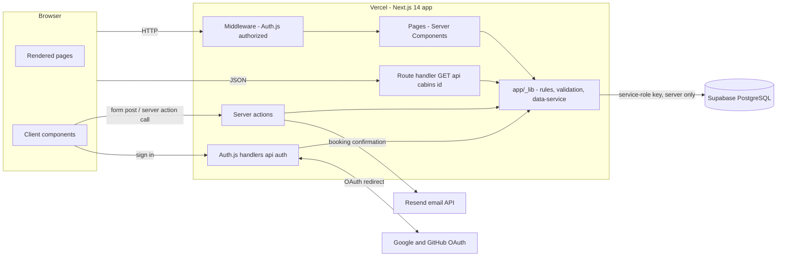
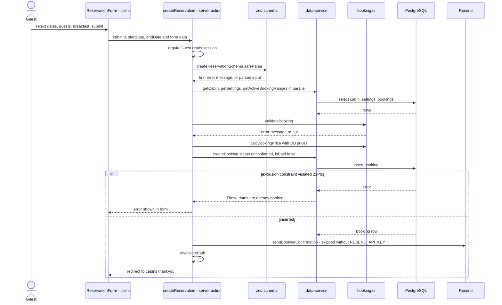
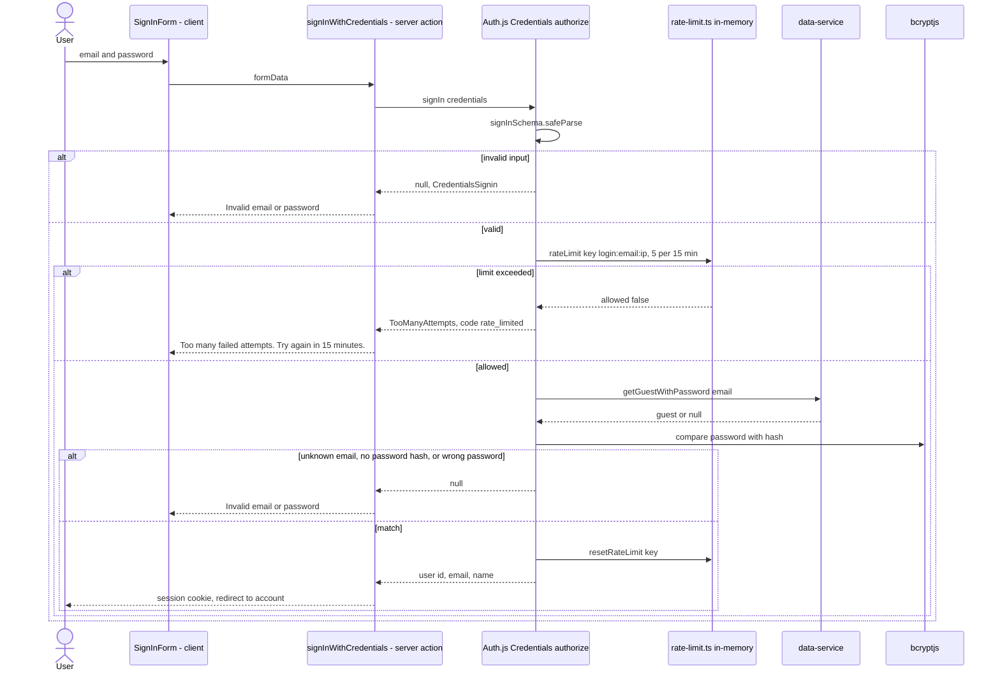

# 2. Architecture

## 2.1 Layers

| Layer | Responsibility | Location |
|---|---|---|
| Pages (React Server Components) | Fetch data on the server and render HTML; compose client components. `app/**/page.js|tsx` and `layout` files. | [`../app`](../app) |
| Client components | Interactivity: date picker, forms with `useFormState`, favorite toggle, filters, optimistic delete. Marked `"use client"`. Shared range state lives in a React context. | [`../app/_components`](../app/_components) |
| Server actions | Mutations called from forms and client components. Each one authenticates, validates with zod, authorizes, then calls the data layer. | [`../app/_lib/action.ts`](../app/_lib/action.ts) |
| Business rules | Pure functions with no I/O: pricing, booking validation, cabin filtering, rate limiter. Unit tested. | [`booking.ts`](../app/_lib/booking.ts), [`cabins.ts`](../app/_lib/cabins.ts), [`rate-limit.ts`](../app/_lib/rate-limit.ts), [`validation.ts`](../app/_lib/validation.ts) |
| Data layer | All Supabase queries; maps database errors to user-facing messages. | [`data-service.ts`](../app/_lib/data-service.ts), [`supabase.ts`](../app/_lib/supabase.ts) |
| Auth | Auth.js configuration, session callbacks, `requireGuest` / `requireAdmin` helpers. | [`auth.ts`](../app/_lib/auth.ts) |
| Middleware | Runs Auth.js `authorized` callback for `/account/*` and `/admin/*`. | [`../middleware.ts`](../middleware.ts) |
| Email | Booking confirmation through the Resend HTTP API. | [`email.ts`](../app/_lib/email.ts) |
| REST API | `GET /api/cabins/:id`; `/api/auth/*` handlers of Auth.js. | [`../app/api`](../app/api) |
| Database | PostgreSQL on Supabase. Schema, constraints and demo data in SQL files. | [`../supabase`](../supabase) |
| Hosting | Vercel builds and serves the Next.js app. | - |

The browser never talks to Supabase. All database access uses the service-role key from server code ([`supabase.ts`](../app/_lib/supabase.ts)).

## 2.2 Component / context diagram

## 2.3 Sequence: create reservation

The client sends only the cabin id and the two calendar dates (`yyyy-MM-dd`) bound to the action, plus the form fields `numGuests`, `observations` and `hasBreakfast`. Prices, nights and the guest identity are never taken from the client. The price shown in the form is a preview computed with the same function ([`calcBookingPrice`](../app/_lib/booking.ts)).

## 2.4 Sequence: credentials login with rate limiting

On each request that reads the session, the `session` callback loads the guest by email and copies `guestId` and `role` into the session.

## 2.5 Rendering notes

- `/cabins` sets `revalidate = 3600`; its filter, search and sort come from URL query parameters (`capacity`, `search`, `sort`).
- `/cabins/[cabinId]` exports `generateStaticParams` (all cabin ids) and also reads the session, so user-specific parts (favorite state, review form, reservation form) are resolved per request.
- All `/account` and `/admin` pages read the session and are therefore dynamic.

## 2.6 Folder structure

| Path | Content |
|---|---|
| `app/page.js`, `layout.js`, `error.js`, `loading.js`, `not-found.js` | Home page, root layout (header, footer, `ReservationProvider`), error and loading states |
| `app/about/` | Static about page |
| `app/cabins/` | Cabin list, cabin detail (`[cabinId]`), availability page, thank-you page |
| `app/login/`, `app/signup/` | Sign-in and sign-up pages |
| `app/account/` | Guest area: welcome, reservations (list and edit), favorites, profile. Layout adds the side navigation |
| `app/admin/` | Admin area: overview, cabins, bookings, guests. Layout checks the role |
| `app/api/` | `auth/[...nextauth]` (Auth.js) and `cabins/[cabinId]` (public JSON) |
| `app/_components/` | UI components (server and client) |
| `app/_lib/` | `action.ts`, `auth.ts`, `booking.ts`, `cabins.ts`, `data-service.ts`, `email.ts`, `rate-limit.ts`, `supabase.ts`, `types.ts`, `validation.ts`, `countries.json` |
| `app/_styles/` | Global CSS (Tailwind) |
| `app/robots.js`, `app/sitemap.js` | `robots.txt` (disallows `/account` and `/api`) and sitemap (home, about, cabins, each cabin) |
| `middleware.ts` | Route protection, matcher `/account/:path*`, `/admin/:path*` |
| `next.config.mjs` | Security headers, remote image hosts, `poweredByHeader: false` |
| `supabase/` | `schema.sql`, `seed.sql`, `migrations/` |
| `__tests__/` | Jest unit tests |
| `load-test.js` | k6 load test script |
| `docs/` | This documentation |
