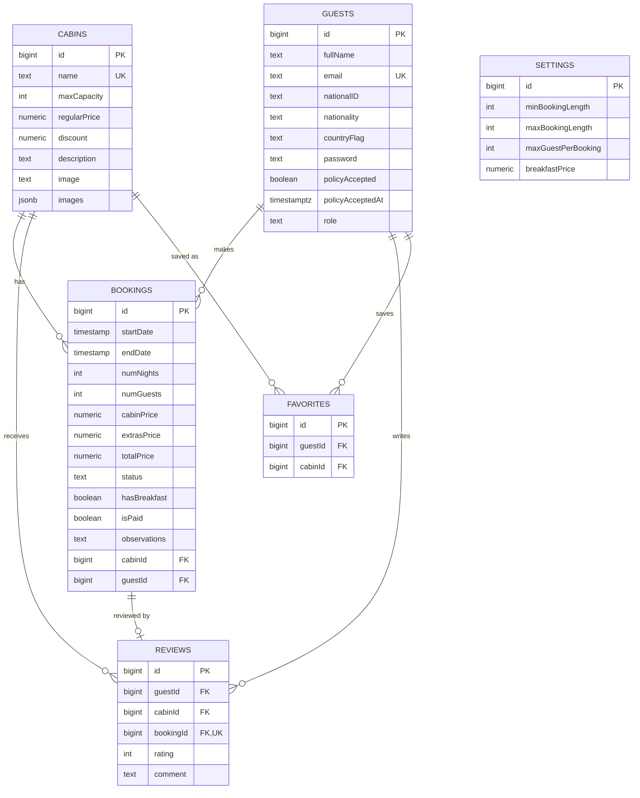

# 4. Data model

Source: [`../supabase/schema.sql`](../supabase/schema.sql) and the TypeScript types in [`../app/_lib/types.ts`](../app/_lib/types.ts). Column names are camelCase and quoted in SQL.

## 4.1 Entity-relationship diagram

`settings` has no relationships: it holds one row of global parameters (the application reads it with `.single()`). Every table also has `created_at timestamptz not null default now()`.

All foreign keys use `on delete cascade`: deleting a cabin or a guest deletes its bookings, reviews and favorites; deleting a booking deletes its review.

## 4.2 Table `cabins`

| Column | Type | Null | Default | Constraint | Meaning |
|---|---|---|---|---|---|
| id | bigint identity | no | generated | primary key | Cabin id |
| created_at | timestamptz | no | `now()` | | Creation time |
| name | text | no | | unique | Display name (for example `001`) |
| maxCapacity | int | no | | `> 0` | Maximum number of guests |
| regularPrice | numeric(10,2) | no | | `>= 0` | Price per night |
| discount | numeric(10,2) | no | `0` | `>= 0`; `discount <= regularPrice` (`discount_le_price`) | Amount subtracted from the price per night |
| description | text | yes | | | Free text |
| image | text | no | | | Main image URL |
| images | jsonb | yes | `'[]'` | | Gallery image URLs |

## 4.3 Table `guests`

| Column | Type | Null | Default | Constraint | Meaning |
|---|---|---|---|---|---|
| id | bigint identity | no | generated | primary key | Guest id; stored in the session as `guestId` |
| created_at | timestamptz | no | `now()` | | Creation time |
| fullName | text | no | | | Display name |
| email | text | no | | unique | Login identity; the link between Auth.js sessions and guests |
| nationalID | text | yes | | validated by the app: 6-12 letters or digits | National ID |
| nationality | text | yes | | | Country name |
| countryFlag | text | yes | | | Flag image URL |
| password | text | yes | | | bcrypt hash; null for guests who only use OAuth |
| policyAccepted | boolean | yes | `false` | | Privacy policy and terms accepted |
| policyAcceptedAt | timestamptz | yes | | | When they were accepted |
| role | text | no | `'guest'` | `in ('guest','admin')` | Authorization role |

## 4.4 Table `bookings`

| Column | Type | Null | Default | Constraint | Meaning |
|---|---|---|---|---|---|
| id | bigint identity | no | generated | primary key | Booking id |
| created_at | timestamptz | no | `now()` | | When it was made |
| startDate | timestamp (no tz) | no | | | Check-in calendar day, at 00:00 |
| endDate | timestamp (no tz) | no | | `endDate > startDate` (`end_after_start`) | Check-out calendar day, at 00:00 |
| numNights | int | no | | `> 0` | Nights stayed |
| numGuests | int | no | | `> 0` | People in the stay (the app also limits it to the cabin capacity) |
| cabinPrice | numeric(10,2) | no | | | `numNights x (regularPrice - discount)` at booking time |
| extrasPrice | numeric(10,2) | no | `0` | | Breakfast total |
| totalPrice | numeric(10,2) | no | | | `cabinPrice + extrasPrice` |
| status | text | no | `'unconfirmed'` | `in ('unconfirmed','checked-in','checked-out')` | Booking status. The application only creates `unconfirmed` |
| hasBreakfast | boolean | no | `false` | | Breakfast add-on chosen |
| isPaid | boolean | no | `false` | | Payment flag; the application always stores `false` |
| observations | text | yes | | | Guest notes (max 1000 characters in the app) |
| cabinId | bigint | no | | FK `cabins(id)` cascade | Booked cabin |
| guestId | bigint | no | | FK `guests(id)` cascade | Owner |

Additional constraints and indexes:

- `no_overlapping_bookings`: `EXCLUDE USING gist ("cabinId" WITH =, tsrange("startDate","endDate",'[)') WITH &&)`. Needs the `btree_gist` extension. The half-open range `[start, end)` allows a booking to start on the day another ends, and prevents double booking even for concurrent requests.
- Index `bookings_guest_idx` on `"guestId"`.

Calendar days: `startDate` and `endDate` are `timestamp without time zone` holding a date at 00:00. The application writes them as `yyyy-MM-dd` strings, so no time zone conversion applies. Prices are stored per booking and are not recomputed when the cabin price changes, except on edit (FR-11).

## 4.5 Table `reviews`

| Column | Type | Null | Default | Constraint | Meaning |
|---|---|---|---|---|---|
| id | bigint identity | no | generated | primary key | Review id |
| created_at | timestamptz | no | `now()` | | Creation time |
| guestId | bigint | no | | FK `guests(id)` cascade | Author |
| cabinId | bigint | no | | FK `cabins(id)` cascade | Reviewed cabin |
| bookingId | bigint | no | | unique; FK `bookings(id)` cascade | The stay being reviewed (one review per booking) |
| rating | int | no | | `between 1 and 5` | Stars |
| comment | text | yes | | `char_length(comment) <= 2000` | Optional text |

Index `reviews_cabin_idx` on `"cabinId"`.

## 4.6 Table `favorites`

| Column | Type | Null | Default | Constraint | Meaning |
|---|---|---|---|---|---|
| id | bigint identity | no | generated | primary key | Row id |
| created_at | timestamptz | no | `now()` | | When saved; list is ordered by it, newest first |
| guestId | bigint | no | | FK `guests(id)` cascade | Owner |
| cabinId | bigint | no | | FK `cabins(id)` cascade | Saved cabin |

Unique `("guestId","cabinId")`.

## 4.7 Table `settings`

| Column | Type | Null | Default | Constraint | Meaning |
|---|---|---|---|---|---|
| id | bigint identity | no | generated | primary key | Row id |
| created_at | timestamptz | no | `now()` | | Creation time |
| minBookingLength | int | no | `2` | `>= 1` | Minimum nights per booking |
| maxBookingLength | int | no | `30` | `>= minBookingLength` | Maximum nights per booking |
| maxGuestPerBooking | int | no | `10` | | Present in the schema; not read by application code |
| breakfastPrice | numeric(10,2) | no | `15` | `>= 0` | Breakfast price per person per night |

The application expects exactly one row. There is no UI to change settings.

## 4.8 Row Level Security

[`schema.sql`](../supabase/schema.sql) enables RLS on all six tables and defines no policies. The application accesses the database only from the server with the service-role key. See [Security](06-security.md).

## 4.9 Migrations

| File | Purpose |
|---|---|
| [`20261120000000_add_guest_role.sql`](../supabase/migrations/20261120000000_add_guest_role.sql) | Adds `guests.role text not null default 'guest'` and the check constraint `guests_role_check` (`role in ('guest','admin')`) if missing. For databases created before the role column existed. |

`schema.sql` already includes the final state for new projects. See [Deployment](07-deployment.md#74-database-setup).
